

  <a href="https://github.com/seo-gali/playground">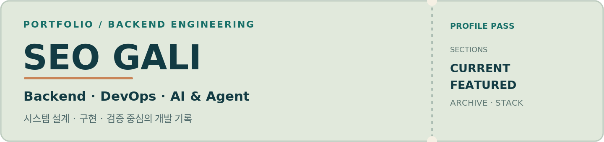</a>

---

## Current Projects

현재 개발·검증 중인 프로젝트입니다.

  <a href="https://github.com/seo-gali/dockslate">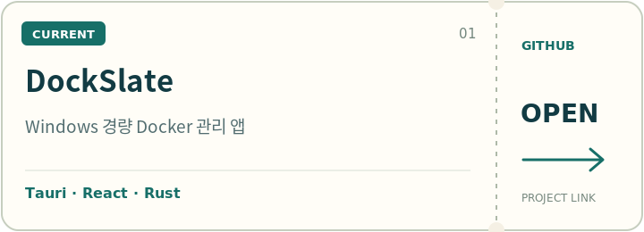</a>
  <a href="https://github.com/seo-gali/what-the-port-win">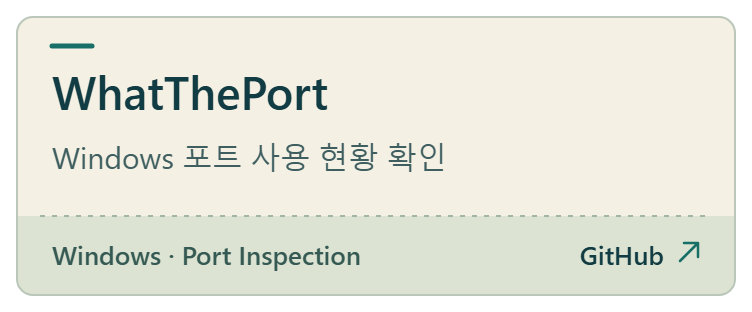</a>
   
  <a href="https://github.com/seo-gali/boiler-ops-agent">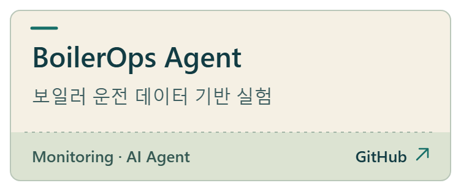</a>
  <a href="https://github.com/seo-gali/qa-viewer">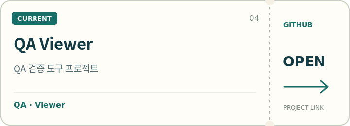</a>
   
  <a href="https://github.com/seo-gali/marketing-ai-agent">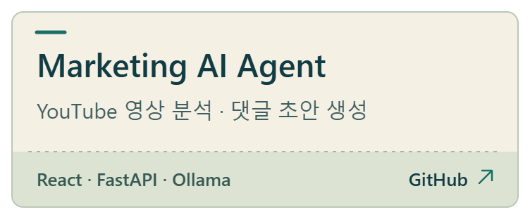</a>

## Featured Projects

개별 프로젝트의 구현·검증 기록은 Notion에서 확인할 수 있습니다.

  <a href="https://app.notion.com/p/galijung/HourBoard-3eedbfd1e0fb80e7a600f051e95e200f">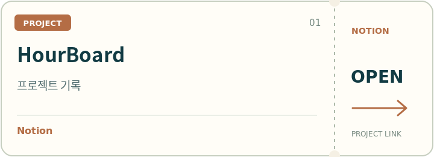</a>
  <a href="https://app.notion.com/p/galijung/SpendGuard-3e6dbfd1e0fb80be830bfbdab1baeda6">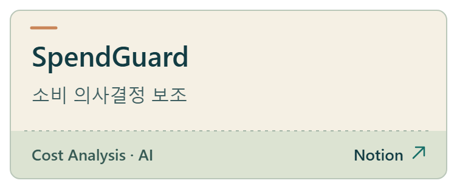</a>
   
  <a href="https://app.notion.com/p/galijung/Pixel-Jukebox-3dfdbfd1e0fb80f1809deb051aefe1bb">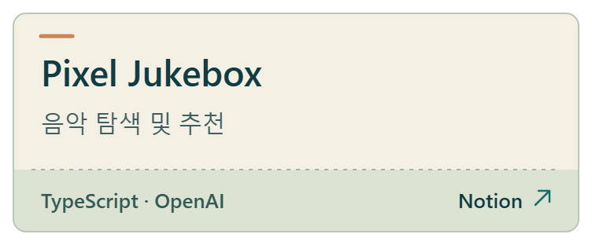</a>
  <a href="https://app.notion.com/p/galijung/MCP-AI-Agent-LAB-3c7dbfd1e0fb8043ab43f291758989eb">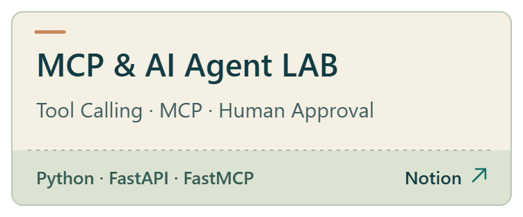</a>
   
  <a href="https://app.notion.com/p/galijung/Spring-AI-RAG-Lab-3b7dbfd1e0fb80e99b99ff023c17bc3d">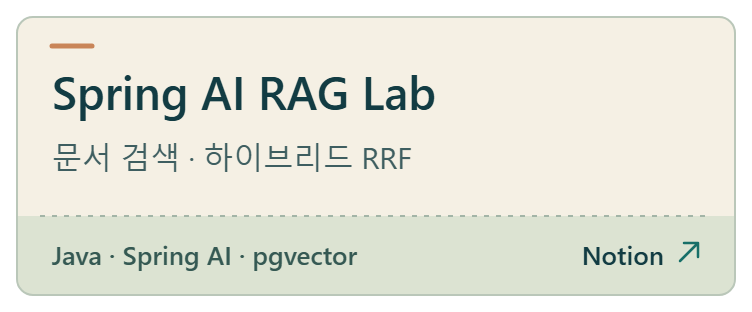</a>
  <a href="https://app.notion.com/p/galijung/Web-Linux-Desktop-3a5dbfd1e0fb802cb1b3e925c2bb24de">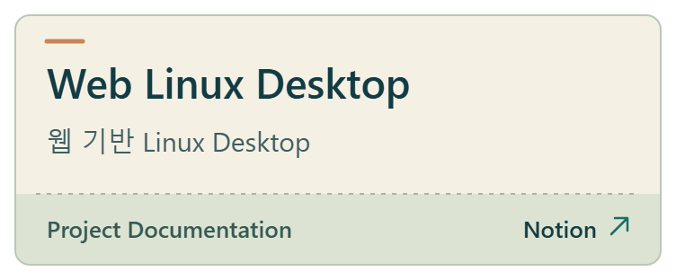</a>
   
  <a href="https://app.notion.com/p/galijung/OfficeGuard-Lab-38edbfd1e0fb80d58f0cd262c83ebb52">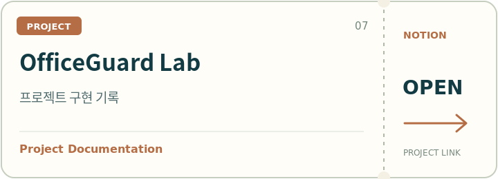</a>
  <a href="https://app.notion.com/p/galijung/ShardStore-S3-37cdbfd1e0fb80e8b439c0c564d31bfb">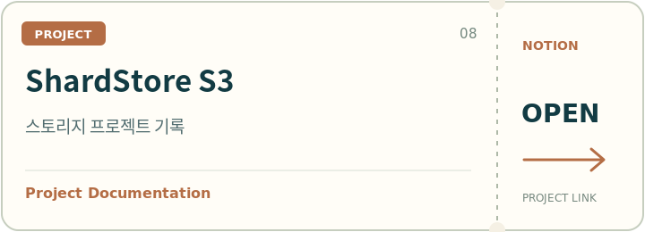</a>
   
  <a href="https://app.notion.com/p/galijung/Mini-PC-Self-Hosted-DevOps-36adbfd1e0fb8012b671c27e6b45ae5b">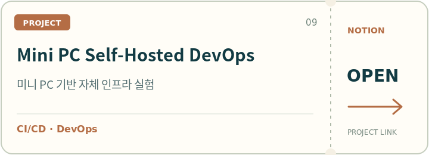</a>
  <a href="https://app.notion.com/p/galijung/Circuit-Breaker-33cdbfd1e0fb817492dff0809c5b33c2">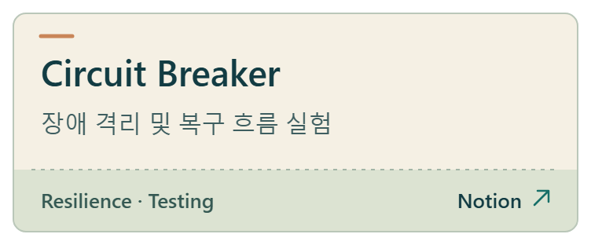</a>
   
  <a href="https://app.notion.com/p/galijung/Server-Monitor-33cdbfd1e0fb81f89b32e8cdf73f59e5">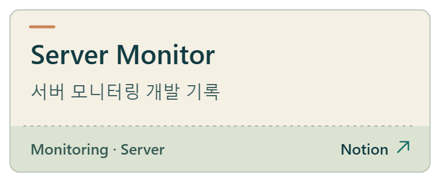</a>

## Portfolio Archive

연도별 업무·교육 프로젝트의 PDF 기록입니다.

| Year | Portfolio |
| :-- | :-- |
| **2026** | [Backend · DevOps · Observability](https://github.com/seo-gali/playground/blob/main/%5B2026%5D%20Backend%20DevOps%20Observability_Portfolio.pdf) |
| **2026** | [Guardian Cloud](https://github.com/seo-gali/playground/blob/main/%5B2026%5D%20KTCloud_Guardian_Cloud_Project.pdf) |
| **2025** | [실시간 모니터링 · 서버 고도화](https://github.com/seo-gali/playground/blob/main/%5B2025%5D%20%ED%8C%8C%EC%BD%A4_%EC%8B%A4%EC%8B%9C%EA%B0%84%20%EB%AA%A8%EB%8B%88%ED%84%B0%EB%A7%81%20%EB%B0%8F%20%EC%84%9C%EB%B2%84%20%EA%B3%A0%EB%8F%84%ED%99%94.pdf) |
| **2023** | [Backend API · 인프라 구축](https://github.com/seo-gali/playground/blob/main/%5B2023%5D%20%ED%8F%AC%EC%8A%A4%ED%8C%9F_Backend%20API%20%EB%B0%8F%20%EC%9D%B8%ED%94%84%EB%9D%BC%20%EA%B5%AC%EC%B6%95%20%ED%94%84%EB%A1%9C%EC%A0%9D%ED%8A%B8.pdf) |
| **2021** | [멀티미디어 융합 Full-stack](https://github.com/seo-gali/playground/blob/main/%5B2021%5D%20%EB%A9%94%EA%B0%80%EC%8A%A4%ED%84%B0%EB%94%94_%EB%A9%80%ED%8B%B0%EB%AF%B8%EB%94%94%EC%96%B4%20%EC%9C%B5%ED%95%A9%20%ED%92%80%EC%8A%A4%ED%83%9D%20%EA%B0%9C%EB%B0%9C.pdf) |
| **2017** | [데이터 모델링 · 설계](https://github.com/seo-gali/playground/blob/main/%5B2017%5D%20%EC%8C%8D%EC%9A%A9%EA%B5%90%EC%9C%A1%EC%84%BC%ED%84%B0_%EB%8D%B0%EC%9D%B4%ED%84%B0%20%EB%AA%A8%EB%8D%B8%EB%A7%81%20%EB%B0%8F%20%EC%84%A4%EA%B3%84%20%ED%94%84%EB%A1%9C%EC%A0%9D%ED%8A%B8.pdf) |

---

## Tech Stack

### Backend

  
  
  
  
   
  
  
  

### Data & Messaging

  
  
  
  
   
  
  
  
  

### AI & Agent

  
  
  
  
  

### AI Development Tools

  
  
  
  

### Frontend

  
  
  
   
  
  
  

### Infra & DevOps

  
  
  
  
   
  
  
  
  

### Development Tools & Collaboration

  
  
  
  
   
  
  

### SEO & Analytics

  
  

### Design

  
  
  
  

---

## SNS

  
  
  

